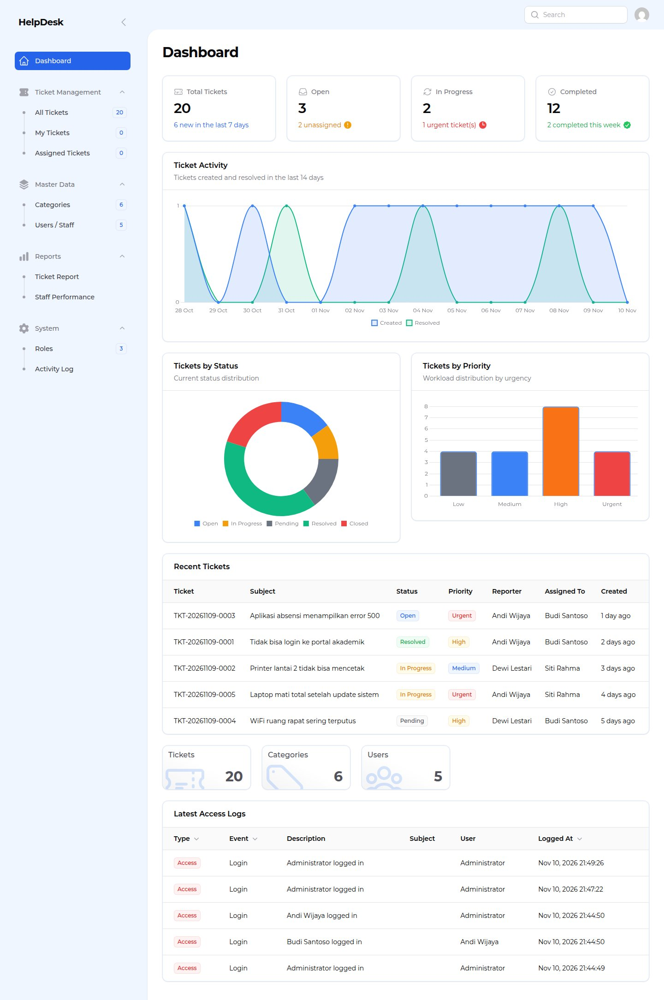
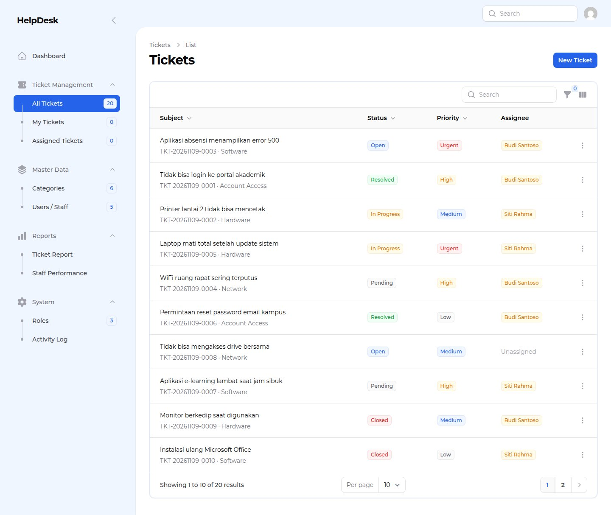
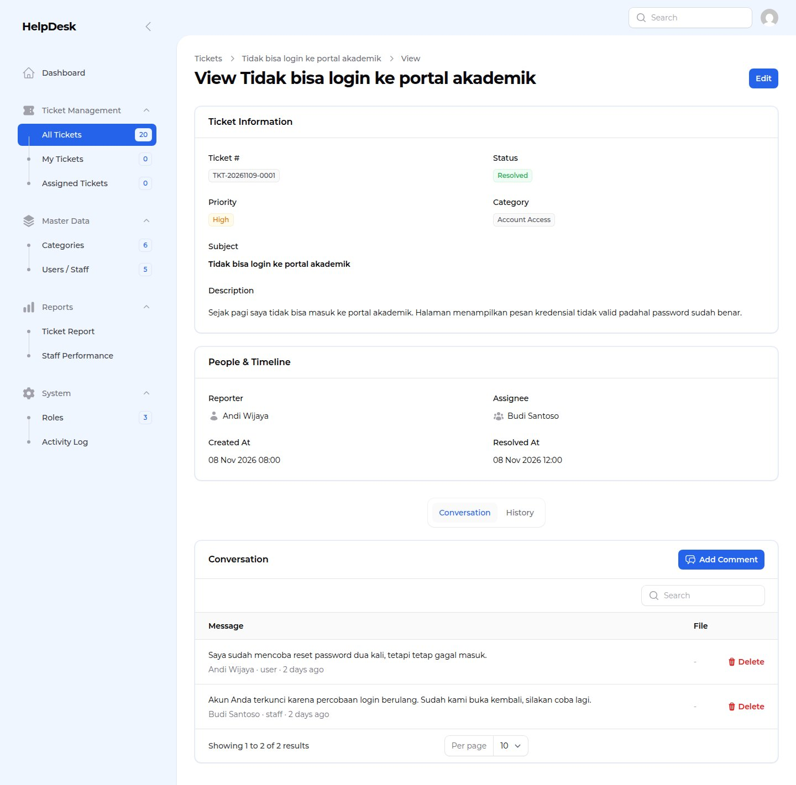
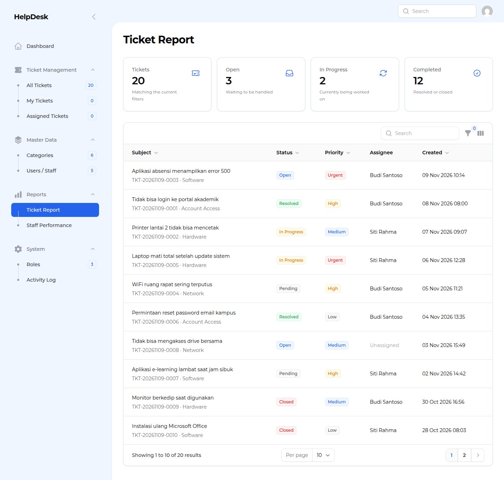
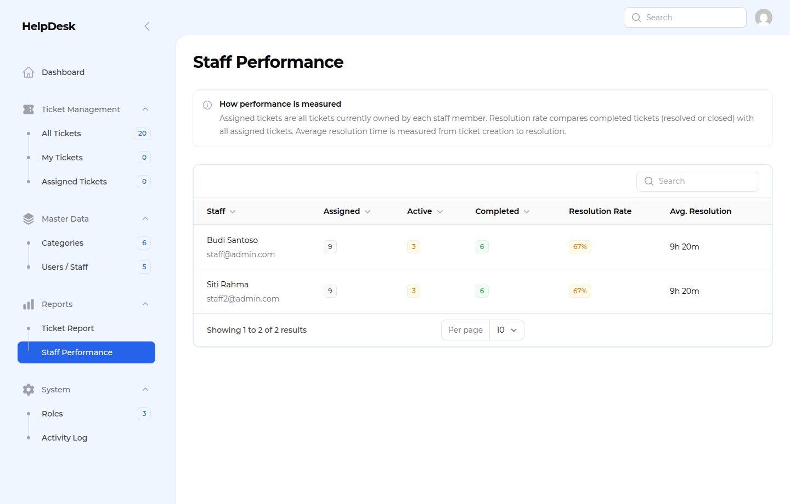
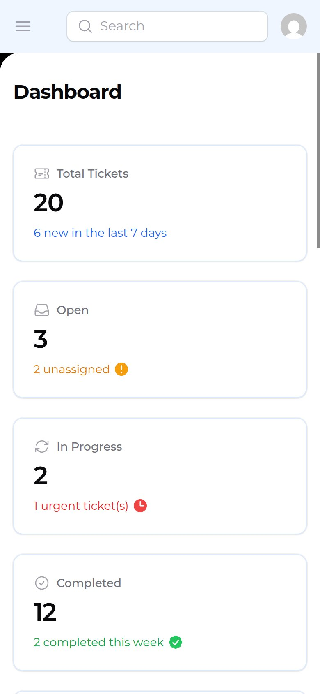
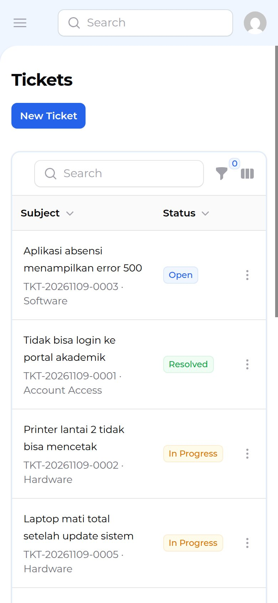
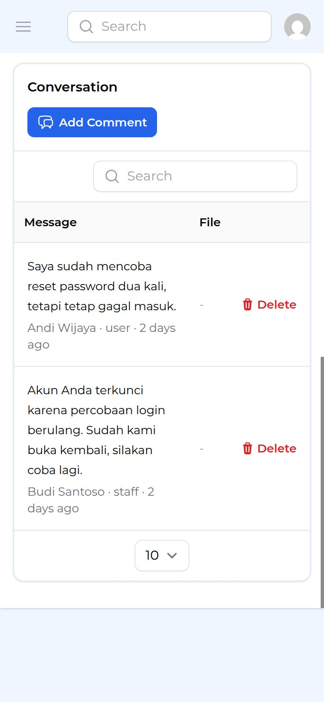

# HelpDesk

A role-aware help desk built with **Laravel 12**, **Filament 3**, and **Livewire 3**. HelpDesk lets end users report problems, lets staff work and resolve tickets, and gives administrators full visibility through dashboards, ticket reports, and staff performance metrics.



## Highlights

- **Three business roles** — Admin, Staff, and Reporter, enforced by both role permissions and per-record ticket policies.
- **Role-aware dashboard** — ticket totals, open/unassigned counts, 14-day activity trend, status and priority charts, recent tickets, and admin-only access logs.
- **Complete ticket workflow** — auto-generated ticket numbers, dynamic categories, priorities, staff assignment, status lifecycle, comments, file attachments, and append-only history.
- **Reporting** — filter tickets by status and date range, review summary statistics, and compare staff workload and resolution metrics.
- **Responsive Filament UI** — desktop and mobile layouts, collapsible navigation, mobile-first tables, and a consistent blue theme.
- **Tested and audited** — 59 Pest tests / 271 assertions, Laravel Pint clean, and a clean Composer security audit.

## Screenshots

| Tickets | Ticket detail |
| --- | --- |
|  |  |

| Ticket report | Staff performance |
| --- | --- |
|  |  |

<details>
<summary>Mobile views</summary>

| Dashboard | Tickets | Ticket detail |
| --- | --- | --- |
|  |  |  |

</details>

## Tech stack

| Layer | Technology |
| --- | --- |
| Backend | Laravel 12 (PHP 8.3) |
| Admin UI | Filament 3.3, Livewire 3, Blade |
| Database | MariaDB 10.11 |
| Authorization | Spatie Permission + Filament Shield + Laravel policies |
| File storage | Laravel `public` disk |
| Testing | Pest 3, PHPUnit 11 |
| Runtime | Docker Compose (PHP-FPM, Nginx, MariaDB) |

## Roles and permissions

There are exactly three roles: `admin`, `staff`, and `user` (reporter).

| Capability | Admin | Staff | Reporter |
| --- | :---: | :---: | :---: |
| View all tickets | ✓ | — | — |
| View assigned + own reported tickets | ✓ | ✓ | — |
| View own reported tickets | ✓ | ✓ | ✓ |
| Create tickets | ✓ | ✓ | ✓ |
| Edit tickets | ✓ | Assigned + own reported | — |
| Assign tickets to staff | ✓ | — | — |
| Delete tickets | ✓ | — | — |
| Comment on tickets | ✓ | Visible, non-closed | Own, non-closed |
| Manage categories, users, roles | ✓ | — | — |
| Ticket report and staff performance | ✓ | — | — |
| Dashboard access logs (Overlook) | ✓ | — | — |

Ticket visibility is implemented twice on purpose:

1. **Query scoping** in `Ticket::scopeVisibleTo()` limits every table, widget, and report query to records the current user may see.
2. **Record authorization** in `TicketPolicy` checks each action (view, update, delete, comment) before it is executed.

Reporter-created tickets are forced to the current reporter with an `Open` status; only staff and admins can change workflow fields such as status and assignment.

## Ticket lifecycle

```
Open → In Progress → Pending → Resolved → Closed
```

- Ticket numbers follow `TKT-YYYYMMDD-0001`, generated inside a database transaction with a per-day sequence and a unique index as the final guard.
- `resolved_at` is set automatically when a ticket becomes **Resolved** and cleared when it returns to an active status.
- Important changes (creation, status, priority, assignee, category, resolution) are appended to `ticket_histories` by `TicketObserver`.
- History is read-only in the UI; there are no edit or delete actions for history records.
- Comments support text and an optional attachment. Deleting a comment is limited to admins or the author, and still requires access to the ticket.

## Attachments

Uploads are validated on the server through Filament's `FileUpload` component.

| Upload | Allowed types | Maximum |
| --- | --- | --- |
| Ticket attachment | JPEG, PNG, GIF, WebP, PDF, DOC/DOCX, XLS/XLSX, TXT, ZIP | 5 MB |
| Comment attachment | JPEG, PNG, GIF, WebP, PDF, TXT, ZIP | 5 MB |

Files are stored on the `public` disk under `tickets/attachments` and `tickets/comments`. For a stricter production deployment, move attachments to a private disk and serve them through authorized download routes.

## Quick start with Docker

### Prerequisites

- Docker with Docker Compose
- `mkcert` (recommended for trusted local HTTPS) or another TLS certificate
- A hosts entry pointing `helpdesk.test` to `127.0.0.1`

```bash
# /etc/hosts
127.0.0.1 helpdesk.test
```

If the browser runs on another device on the same network, point `helpdesk.test` to the server's LAN IP instead, or open `https://<server-ip>:8444` and accept the local certificate warning. The development certificate can include both the hostname and the LAN IP (see below).

### 1. Configure environment files

```bash
cp .env.example .env
cp src/.env.example src/.env
```

Edit both files:

- Set strong, matching database passwords in the root `.env` and in `src/.env` (`DB_PASSWORD`).
- Set `APP_URL` to the URL you will open, for example `https://helpdesk.test:8444`.
- Leave `ASSET_URL` empty so assets follow the host used in the browser (hostname or LAN IP).
- For production, set `APP_ENV=production`, `APP_DEBUG=false`, and provide `ADMIN_EMAIL` / `ADMIN_PASSWORD` in `src/.env`.

`.env` files are ignored by Git and must never be committed.

### 2. Generate a local TLS certificate

```bash
mkdir -p nginx/ssl
mkcert -install
mkcert \
  -cert-file nginx/ssl/helpdesk.test.crt \
  -key-file nginx/ssl/helpdesk.test.key \
  helpdesk.test localhost 127.0.0.1
```

The certificate and private key are ignored by Git. If you use a different hostname, update `server_name` in `nginx/default.conf` and the URLs in both `.env` files.

### 3. Start the containers

```bash
docker compose up -d --build
```

The PHP entrypoint waits for MariaDB, installs Composer dependencies if `vendor/` is missing, generates `APP_KEY` when needed, creates the storage link, runs pending migrations (never `migrate:fresh`), and clears caches.

### 4. Initialize roles, permissions, and demo data

```bash
docker exec helpdesk_php php artisan project:init
```

`project:init` is idempotent and **never deletes data**. It runs migrations, generates Shield permissions without overwriting custom policies, and seeds roles, categories, users, and demo tickets. Demo users and demo tickets are only created outside production and only when the ticket table is empty.

### 5. Build front-end assets (optional)

Prebuilt assets are included in the repository. Rebuild them only after changing styles or JavaScript:

```bash
docker exec helpdesk_php npm ci
docker exec helpdesk_php npm run build
```

### 6. Open the application

- Application: <https://helpdesk.test:8444/admin>
- HTTP is redirected automatically from port `8083` to HTTPS port `8444`.

### Demo accounts

Available only when `APP_ENV` is not `production`:

| Role | Email | Password |
| --- | --- | --- |
| Admin | `admin@admin.com` | `password` |
| Staff | `staff@admin.com` | `password` |
| Staff | `staff2@admin.com` | `password` |
| Reporter | `user@admin.com` | `password` |
| Reporter | `user2@admin.com` | `password` |

The demo password can be changed with `DEMO_PASSWORD` in `src/.env`. In production, only the admin account is seeded, using `ADMIN_EMAIL` and `ADMIN_PASSWORD`; demo users and demo tickets are skipped.

## Development commands

```bash
# Run the full test suite (SQLite in-memory)
docker exec helpdesk_php php artisan test

# Check code style
docker exec helpdesk_php ./vendor/bin/pint --test

# Fix code style
docker exec helpdesk_php ./vendor/bin/pint

# Audit PHP dependencies
docker exec helpdesk_php composer audit

# Run pending migrations
docker exec helpdesk_php php artisan migrate
```

## Project structure

```
.
├── .github/workflows/tests.yml   # CI: Pint, Pest, Composer audit, asset build
├── docker-compose.yml            # PHP-FPM, Nginx, MariaDB
├── db/                           # MariaDB configuration and runtime data (data ignored)
├── docs/screenshots/             # Portfolio screenshots
├── nginx/                        # Nginx TLS configuration (certificates ignored)
├── php/                          # PHP image and container entrypoint
└── src/                          # Laravel application
    ├── app/Enums/                # Ticket status and priority enums
    ├── app/Filament/Admin/       # Resources, pages, relation managers, widgets
    ├── app/Models/               # Ticket, category, comment, history, user
    ├── app/Observers/            # Append-only ticket history
    ├── app/Policies/             # Per-record authorization
    ├── database/seeders/         # Roles, permissions, categories, demo data
    └── tests/Feature/            # Authorization, dashboard, report, upload tests
```

## Security notes

- Role checks and per-record policies are both enforced; hidden navigation is not used as an authorization boundary.
- Filament login is rate-limited to five attempts per minute.
- Sessions are encrypted and use secure cookies in HTTPS deployments; passwords are hashed with bcrypt (cost 12).
- Upload type and size limits are enforced server-side, not only in the browser.
- History records are append-only at the application level and read-only in the UI.
- Ticket deletion is restricted to admins and is available only from the ticket edit page; there are no bulk deletion actions.
- `.env`, local database data, generated TLS keys, and credentials are excluded from version control.

## Notes and possible next steps

This project is designed as a portfolio-ready demo. Natural production extensions would be private attachment storage with authorized downloads, email notifications, SLA timers, and a REST API for external integrations.

---

Built with Laravel 12 and Filament 3.
